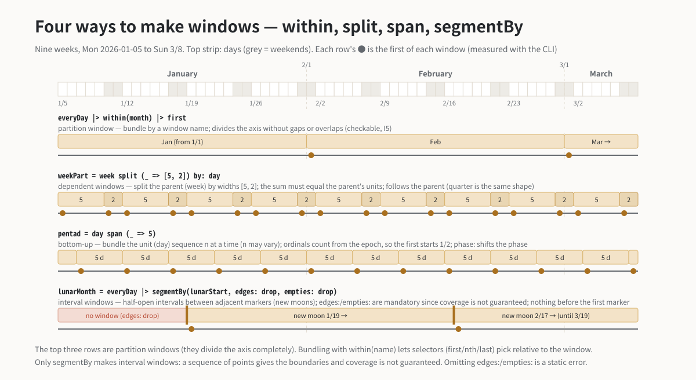

# `within` — the partition-type window

> Translated from the canonical Japanese page [reference/within.md](../../reference/within.md).
> The `source_sha` above records the source revision; a consistency check flags this page when the
> Japanese original changes.

**Category**: window (body-layer core) / **Signature**:
`within(w) : Stream -> Stream(partitioned)` / name settled (spec §5.4)

<p align="center"></p>

## Meaning

Bundles the stream by the partition-type window (a window that partitions the axis without
remainder) that the window name `w` refers to. The window name resolves under the in-scope premise
(`month` is the Gregorian calendar month; under `@FY`, `year` is the fiscal year). Once bundled,
the selectors ([`first`](first.md)/[`nth`](nth.md)/[`last`](last.md)) can pick "the window-relative
Nth" (I4).

Partition-type windows are **checkable for exhaustiveness and non-overlap** (I5) — windows made by
`grid`/`span`/`split` are certified structurally; windows made by `segmentBy` (such as `week`) by
the check.

## Arguments

| Argument | Meaning |
|---|---|
| `w` | A window name (`day`/`week`/`month`/`quarter`/`year`, or a user-defined partition window). Resolved premise-relative |

## Examples

The last day of each month (the core expansion of the public boundary word `monthEnd`):

```kairos
# eval: 2026-01-01..2026-04-01
@JP
everyDay |> within(month) |> last
#=> 2026-01-31 2026-02-28 2026-03-31
```

When nested, selectors bind by default to the **innermost window**. When ambiguous, make it
explicit with `of:`:

```kairos
# eval: 2026-01-01..2026-04-01
@JP
everyDay |> within(quarter) |> within(month) |> nth(2, of: month)
#=> 2026-01-02 2026-02-02 2026-03-02
```

## Pitfalls

- A selector without a window is a type error (I4). `everyDay |> first` cannot be written.
- `within(week)` requires a `wkst:` declaration in the preamble (the week's cut depends on WKST;
  undeclared is a static error. stdlib/gregorian.md §4.5).
- Windows cut by markers (fiscal closes, lunar phases) cannot be **built** with `within` — build
  them with [`segmentBy`](segmentBy.md). The argument kinds differ fundamentally, so the two are
  not unified (ADR-08 — but **acceptance** is decided by property: once the window sequence is an
  effective partition, `within(its name)` can group by it, and a rule-marker-built one can also be
  the parent of [`split`](split.md). ADR-08 addendum · ADR-48).

## Related

[`segmentBy`](segmentBy.md) · selectors ([`first`](first.md)/[`nth`](nth.md)/[`last`](last.md)) ·
[`ordinalIn`](ordinalIn.md) (the window-to-value dual) · ADR-06/07/08/24 · I4/I5.
