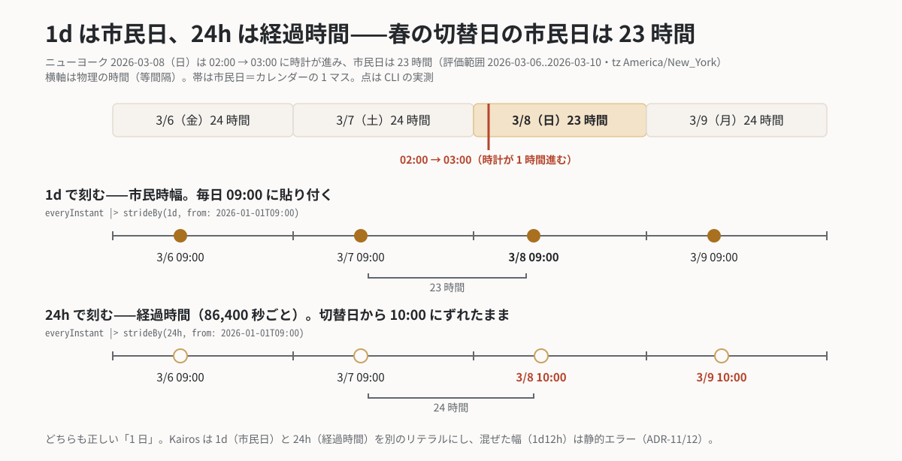

# `strideBy` — 幅で刻む「w ごと」

**分類**: ストライド（本体層 core） ／ **シグネチャ**: `strideBy(w, from:) : Stream -> Stream` ／ 名は確定（spec §5.4）

## 意味

起点 `from:` から**幅 `w` の等差**で点を刻む。[`stride`](stride.md) が「入力の点を n 個ごと」
（**点で数える**）なのに対し、`strideBy` は「物理量 w ごと」（**幅で刻む**）——暦のリズムに
乗らない周期（火星の 1 sol・90 分ごと・36 時間ごと）のための演算子で、引数の種類の違いから
[`take`](take.md)・[`takeLast`](takeLast.md) とともにストライド族四演算子に割られている
（spec §4.7・ADR-38/49/52）。

起点 `from:` は必須（ADR-31。stride と一族共通の規則）。**from: は前方専用**——起点より前へは
刻まない（起点前の評価範囲は黙って空になる。壁時計 tick を全期間に張るなら、from: に**単独時刻
リテラル** `Thh:mm` を渡す＝epoch 錨日 1970-01-01 での錨打ちで欠落が構造的に消える。市民日幅
1d 専用・ADR-51。日付つき anchor を書くなら評価範囲より前の日付を選ぶこと）。

## 例

36 時間ごと（経過時間の複合幅）:

```kairos
# eval: 2026-01-01..2026-01-05
@JP
everyInstant |> strideBy(36h, from: 2026-01-01)
#=> 2026-01-01 2026-01-02T12:00 2026-01-04
```

火星の 1 sol ごとは [`everyInstant`](everyInstant.md) の例を参照
（`strideBy(24h39m35.244s, from: …)`）。

## 落とし穴

- 幅の規約に注意: `d` は**市民日**（DST で伸縮。うるう秒はスコープ外＝ADR-33）、`h`/`m`/`s` は**経過時間**。混合
  （`1d12h`）は静的エラー（ADR-12/28）。「毎日同じ時刻」が欲しいなら市民時（暦）の演算で、
  「86400 秒ごと」が欲しいなら経過時間で——両者は DST の日にずれる。
- 「3 営業日ごと」のような**数えの**間引きは [`stride`](stride.md)。`strideBy` は数えず測る。

<p align="center"></p>

## 関連

[`stride`](stride.md)・[`take`](take.md)・[`everyInstant`](everyInstant.md)・幅リテラル（spec §5.5・ADR-11/12/28）。
