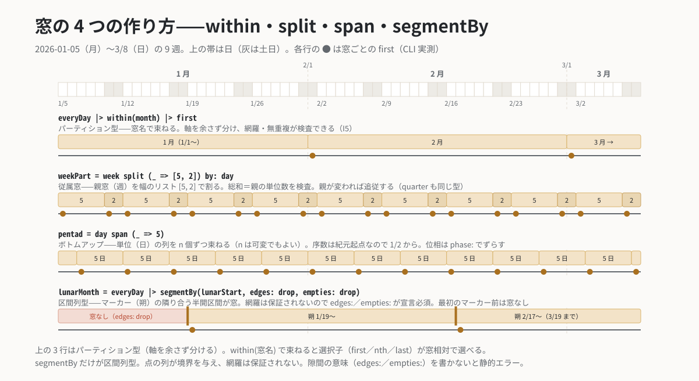

# `within` — パーティション型窓

**分類**: 窓（本体層 core） ／ **シグネチャ**: `within(w) : Stream -> Stream(partitioned)` ／ 名は確定（spec §5.4）

<p align="center"></p>

## 意味

ストリームを、窓名 `w` が指すパーティション型窓（軸を余さず分割する窓）で束ねる。窓名は在圏 premise の
下で解決される（`month` は Gregorian の暦月、`@FY` の下なら `year` は会計年度）。束ねた後は選択子
（[`first`](first.md)/[`nth`](nth.md)/[`last`](last.md)）が「窓相対の第 N」を選べるようになる（I4）。

パーティション型窓は**網羅・無重複が検査可能**（I5）——`grid`/`span`/`split` 製の窓は構造的に、
`segmentBy` 製の窓（`week` など）は検査で認定される。

## 引数

| 引数 | 意味 |
|---|---|
| `w` | 窓名（`day`/`week`/`month`/`quarter`/`year`、またはユーザ定義のパーティション窓）。premise 相対に解決 |

## 例

各月の最終日（公開境界語 `monthEnd` の core 展開）:

```kairos
# eval: 2026-01-01..2026-04-01
@JP
everyDay |> within(month) |> last
#=> 2026-01-31 2026-02-28 2026-03-31
```

入れ子にすると選択子は既定で**最内窓**に束縛される。曖昧なら `of:` で明示する:

```kairos
# eval: 2026-01-01..2026-04-01
@JP
everyDay |> within(quarter) |> within(month) |> nth(2, of: month)
#=> 2026-01-02 2026-02-02 2026-03-02
```

## 落とし穴

- 窓なしの選択子は型エラー（I4）。`everyDay |> first` は書けない。
- `within(week)` は前文の `wkst:` 宣言が必須（週の切れ目は WKST 依存。未宣言は静的エラー。
  stdlib/gregorian.md §4.5）。
- マーカーで切る窓（決算期・月相）は `within` では**作れない**——作るのは [`segmentBy`](segmentBy.md)。
  引数の種類が根本的に違うため一本化していない（ADR-08——ただし**受理**は性質で決まる: できた
  窓列が実効パーティションなら `within(その名前)` で束ねられるし、規則マーカー由来なら
  [`split`](split.md) の親にもなれる。ADR-08 追記・ADR-48）。

## 関連

[`segmentBy`](segmentBy.md)・選択子（[`first`](first.md)/[`nth`](nth.md)/[`last`](last.md)）・
[`ordinalIn`](ordinalIn.md)（窓→値の双対）・ADR-06/07/08/24・I4/I5。
